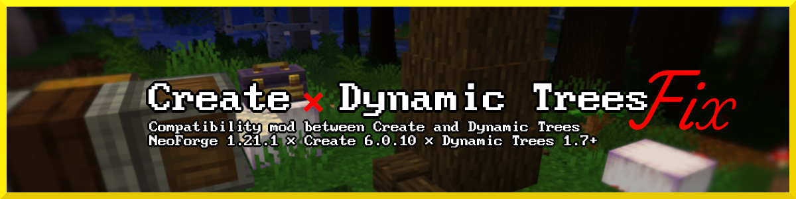

**Makes Create machines work with Dynamic Trees again.**

In Create 6.0.10 the Dynamic Trees support is switched off in the code. A Mechanical Saw cuts a Dynamic Tree, the tree disappears, and **nothing drops**. This mod fixes that, and more.

## 🪚 Before vs after

| Machine / situation | Without this mod | With this mod |
|---|---|---|
| Mechanical Saw on a contraption | Tree vanishes, no drops | Whole tree is cut, drops go into contraption storage, tree falls |
| Stationary Mechanical Saw | Tree vanishes, no drops | Whole tree is cut, drops land in front of the saw |
| Mechanical Drill (moving or stationary) | Tree vanishes, no drops | Same as the saw |
| Deployer with an axe | Drops scatter where the tree lands | Drops go into the deployer, then to storage |
| Surface root in front of a saw | Contraption stops | Saw cuts the root |
| Axe on a surface root | Bare-hand speed | Log speed |
| Saw cuts a root or a vanilla log next to a Dynamic Tree | Create's vanilla tree cutter can delete the whole Dynamic Tree with no drops | Dynamic Trees are left alone |
| Break cracks on branches | Sometimes missing | Always shown |

## ✨ What it does
- **Mechanical Saw** cuts a whole Dynamic Tree. Drops go into contraption storage (moving saw) or on the ground (stationary saw).
- **Mechanical Drill**, the plough, and add-on breakers that use Create's breaker code do the same.
- The tree **falls away from the machine**, like a tree a player cuts. The fall is an animation only: no duplicate drops.
- **Deployer with an axe**: drops go to the deployer, then to contraption storage or out of the deployer. Fortune and Silk Touch work.
- **Surface roots**: saws cut them, so a root no longer stops a contraption. Axes (player or deployer) cut roots at log speed.
- **No more vanished trees**: Create's vanilla tree cutter no longer deletes a Dynamic Tree with no drops.
- **Break cracks** always show on branches.
- **Config file** with one on/off switch per fix (all on by default). See below.

## 📦 Requirements
| | Version |
|---|---|
| Minecraft | 1.21.1 |
| NeoForge | 21.1.219 or newer |
| Create | 6.0.10 or newer 6.0.x |
| Dynamic Trees | 1.7.0 or newer |

**Server-side only.** Install it on the server (or in single player). Players without the mod can still join.

## 🧰 For modpack makers
- **Server-side only.** Players do not need it. Clients with or without it can join.
- **Safe to add or remove at any time.** It adds no blocks, no items and no saved data. Remove it and the world loads as if it was never there.
- **Free to include in any modpack**, on any platform. It is MIT licensed. No need to ask.
- **Safe with Create updates.** If a Create 6.0.x update changes code this mod needs, only that one fix turns off, with a line in the log. The game does not crash. If Create fixes the saw itself, this mod's saw fix turns off and the other fixes stay on.
- **Config:** `config/create_dt_fix-common.toml`. Ship it in your pack's `config` folder to set the defaults.
- **Do not use it together with** the old "Dynamic Trees Create Compat" add-on. That add-on does not work on Create 6.

## ⚙️ Config
`config/create_dt_fix-common.toml`. Every switch is on by default. Changes apply when you save the file, with no restart.

| Switch | What it does |
|---|---|
| `breakerFix` | Drill, plough and add-on breakers do the same |
| `fallAwayFromMachine` | The tree falls away from the machine (off: random direction) |
| `deployerDrops` | A deployer with an axe gets the drops |
| `sawCutsRoots` | Saws cut surface roots |
| `axeRootSpeed` | Axes cut surface roots at log speed |
| `breakCracks` | Break cracks always show on branches |

The saw fix and the guard that stops Create's vanilla tree cutter from deleting Dynamic Trees have no switch. Turning them off would only bring the bug back. The saw fix turns itself off if Create ships its own fix.

## ✅ Tested with
- Minecraft 1.21.1, NeoForge 21.1.264
- Create 6.0.10
- Dynamic Trees 1.7.2, Dynamic Trees Plus 1.3.2
- In the same pack (about 250 mods): Dynamic Trees add-ons for Biomes O' Plenty, Oh The Biomes We've Gone, Quark, Regions Unexplored, Terralith and Ars Nouveau

## ❓ FAQ
**Do players need this mod?**
No. Only the server (or the single-player world) needs it.

**Does it work with Dynamic Trees add-ons (Dynamic Trees Plus and others)?**
Yes. The fixes work on every Dynamic Trees tree type, including add-on trees and mushroom trees.

**What happens when Create updates?**
Create has a pending fix for the saw (Create issue #9657, PR #9898). Any Create 6.0.x from 6.0.10 is allowed. At launch, the mod checks Create's code. If something it needs has changed, only that fix turns off, with a line in the log. If Create ships its own saw fix, this mod's saw fix turns off and the rest stay on. Create 6.1 or newer stops the game at launch with a clear message, so I can check it first.

**Why does my axe lose durability in a deployer?**
That is Dynamic Trees' own design. Set `axeDamageMode` to `VANILLA` in `dynamictrees-server.toml` for 1 damage per tree.

**Is anything not covered?**
The Create roller. It uses its own break code.

## 🤖 How this mod was made
This mod is **vibe coded**, and it carries Modrinth's *Contains AI-generated content* disclosure. I am the pack maker who found the bug, tested every build in my own pack and decided what the mod should do. The code itself was written by an AI (Claude, by Anthropic) in a chat session, from reading the Create and Dynamic Trees source code. Parts of this page were also drafted with that AI. I am not a Java programmer, so I cannot take credit for the code.

All images on this page are real, unedited screenshots from the game.

What that means for you:
- Every feature was tested in game in a large NeoForge 1.21.1 pack (saw, drill, deployer, roots, thick trees, mushroom trees).
- Every mixin target was checked against the real Create 6.0.10 and Dynamic Trees 1.7.2 jars.
- Bug reports are welcome on [GitHub](https://github.com/ArdRiMods/create-dt-fix/issues). Please attach `logs/latest.log`.

## 🙏 Credits
- Saw compat logic based on Create PR #9898 (MIT, The Create Team).
- Dynamic Trees by DynamicTreesTeam (MIT).
- Icon and banner by ArdRiMods, made from real in-game screenshots (no AI), licensed CC BY-SA 4.0.
- Title font: *BigBlue Terminal* by VileR ([int10h.org](https://int10h.org)), CC BY-SA 4.0. "Fix" font: *Playwrite BE VLG* by The Playwrite Project Authors, SIL OFL 1.1.
- Code written by Claude (Anthropic AI). Idea, testing and design decisions by ArdRiMods.
- Not affiliated with the Create team or the Dynamic Trees team.
