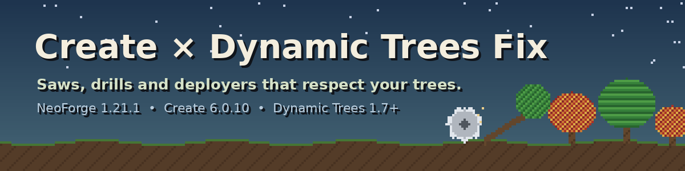

**Makes Create machines work with Dynamic Trees again.**

In Create 6.0.10 the Dynamic Trees support is switched off in the code. A Mechanical Saw cuts a Dynamic Tree, the tree disappears, and **nothing drops**. This mod fixes that, and more.

## 🪚 Before vs after

| Machine / situation | Without this mod | With this mod |
|---|---|---|
| Mechanical Saw on a contraption | Tree vanishes, no drops | Whole tree is cut, drops go into contraption storage, tree falls |
| Stationary Mechanical Saw | Tree vanishes, no drops | Whole tree is cut, drops land in front of the saw |
| Mechanical Drill (moving or stationary) | Tree vanishes, no drops | Same as the saw |
| Deployer with an axe | Drops scatter where the tree lands | Drops go into the deployer, then to storage |
| Surface root in front of a saw | Contraption stops | Saw cuts the root |
| Axe on a surface root | Bare-hand speed | Log speed |
| Saw cuts a root or a vanilla log next to a Dynamic Tree | Create's vanilla tree cutter can delete the whole Dynamic Tree with no drops | Dynamic Trees are left alone |
| Break cracks on branches | Sometimes missing | Always shown |

## ✨ What it does
- **Mechanical Saw** cuts a whole Dynamic Tree. Drops go into contraption storage (moving saw) or on the ground (stationary saw).
- **Mechanical Drill**, the plough, and add-on breakers that use Create's breaker code do the same.
- The tree **falls away from the machine**, like a tree a player cuts. The fall is an animation only: no duplicate drops.
- **Deployer with an axe**: drops go to the deployer, then to contraption storage or out of the deployer. Fortune and Silk Touch work.
- **Surface roots**: saws cut them, so a root no longer stops a contraption. Axes (player or deployer) cut roots at log speed.
- **No more vanished trees**: Create's vanilla tree cutter no longer deletes a Dynamic Tree with no drops.
- **Break cracks** always show on branches.

## 📦 Requirements
| | Version |
|---|---|
| Minecraft | 1.21.1 |
| NeoForge | 21.1.219 or newer |
| Create | **6.0.10** (exact) |
| Dynamic Trees | 1.7.0 or newer |

**Server-side only.** Install it on the server (or in single player). Players without the mod can still join.

## ❓ FAQ
**Do players need this mod?**
No. Only the server (or the single-player world) needs it.

**Does it work with Dynamic Trees add-ons (Dynamic Trees Plus and others)?**
Yes. The fixes work on every Dynamic Trees tree type, including add-on trees and mushroom trees.

**Why "Create 6.0.10 exact"?**
Create has a pending fix for the saw (Create issue #9657, PR #9898). When a new Create version comes out, this mod stops the game at launch with a clear message. Then I check the new Create and update this mod (or retire it, if Create fixed everything).

**Why does my axe lose durability in a deployer?**
That is Dynamic Trees' own design. Set `axeDamageMode` to `VANILLA` in `dynamictrees-server.toml` for 1 damage per tree.

**Is anything not covered?**
The Create roller. It uses its own break code.

## 🤖 How this mod was made
This mod is **vibe coded**. I am the pack maker who found the bug, tested every build in my own pack and decided what the mod should do. The code itself was written by an AI (Claude, by Anthropic) in a chat session, from reading the Create and Dynamic Trees source code. I am not a Java programmer, so I cannot take credit for the code.

What that means for you:
- Every feature was tested in game in a large NeoForge 1.21.1 pack (saw, drill, deployer, roots, thick trees, mushroom trees).
- Every mixin target was checked against the real Create 6.0.10 and Dynamic Trees 1.7.2 jars.
- Bug reports are welcome on [GitHub](https://github.com/ArdRiMods/create-dt-fix/issues). Please attach `logs/latest.log`.

## 🙏 Credits
- Saw compat logic based on Create PR #9898 (MIT, The Create Team).
- Dynamic Trees by DynamicTreesTeam (MIT).
- Code written by Claude (Anthropic AI). Idea, testing and design decisions by ArdRiMods.
- Not affiliated with the Create team or the Dynamic Trees team.

## Building
Two ways:

1. **Gradle** (needs internet): `./gradlew build`. The jar is in `build/libs/`.
2. **Offline, with javac**: put these jars in one folder, then run `./build.sh <folder>`:
   - `create-1.21.1-6.0.10.jar` and `dynamictrees-neoforge-1.21.1-1.7.x.jar` (from `mods/`)
   - From the launcher `libraries/` folder: `neoforge-21.1.x-client.jar`, `neoforge-21.1.x-universal.jar`, `client-1.21.1-<date>-srg.jar`, `loader-4.0.x.jar`, `sponge-mixin-*.jar`
